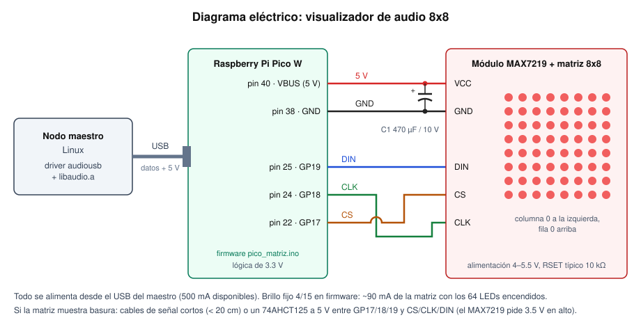

# Matriz de LEDs 8x8: hardware, firmware y libaudio.a

Cadena completa:

```
nodo maestro ── libaudio.a ── ioctl ── driver audiousb ── USB bulk ── Pico W ── GPIO ── MAX7219 ── LEDs
```

| Pieza | Archivo |
|---|---|
| Biblioteca (único acceso al driver) | `include/lib/libaudio.h`, `src/lib/libaudio.c` |
| Contrato driver ↔ biblioteca ↔ firmware | `src/driver/audiousb_ioctl.h` |
| Firmware de la Pico | `src/firmware/pico_matriz/pico_matriz.ino` |
| Diagrama eléctrico | `docs/hardware/diagrama_conexiones.svg` |
| Pruebas | `pruebas/probar_libaudio.c` (sin hardware), `pruebas/demo_matriz.c` (con la matriz) |

## Conexiones



| Pico W (pin físico) | Señal | Módulo MAX7219 |
|---|---|---|
| 40 · VBUS | 5 V | VCC |
| 38 · GND (o el 23) | GND | GND |
| 25 · GP19 | datos | DIN |
| 24 · GP18 | reloj | CLK |
| 22 · GP17 | carga | CS |

El pin 23 también es GND y queda entre GP17 y GP18. Sirve para llevar las cinco señales en un solo tramo de cable plano.

## Alimentación

Todo se alimenta del puerto USB del nodo maestro: el mismo cable lleva datos y 5 V. Un puerto USB 2.0 entrega 500 mA.

| Consumidor | Corriente |
|---|---|
| Pico W (WiFi apagado) | ~30–50 mA |
| MAX7219 (en reposo) | ~8 mA |
| LEDs, brillo 4/15, los 64 encendidos | ~90 mA promedio |
| **Total en el peor caso con brillo 4** | **~150 mA** |
| LEDs con brillo 15/15, los 64 encendidos | ~310 mA (no usar) |

Cálculo: el MAX7219 enciende una columna a la vez (8 LEDs), a unos 40 mA por LED con `RSET` de 10 kΩ. El pico es 8 × 40 = 320 mA, y el promedio lo escala el ciclo de trabajo de la intensidad, `(2n+1)/32`. Con n = 4 queda 9/32 → ~90 mA. El brillo está fijo en `BRILLO` dentro del firmware.

- **C1 (470 µF / 10 V, electrolítico)** entre VCC y GND, pegado al módulo. Absorbe los picos de 320 mA del barrido para que no bajen el voltaje de la Pico. Es opcional con cables cortos, pero barato.
- Revisa el `RSET` de tu módulo: es la resistencia marcada `103` (10 kΩ) junto al chip. Si es menor, la corriente por LED sube y conviene bajar `BRILLO`.

## Puesta en marcha

1. **Firmware.** En Arduino IDE elige la placa *Raspberry Pi Pico W* y en **Herramientas → USB Stack** elige **Adafruit TinyUSB**. Carga `src/firmware/pico_matriz/pico_matriz.ino`. Al encender se ve un corazón: eso confirma que la Pico controla bien el MAX7219.
2. **USB en Linux.** `lsusb | grep 2e8a:4001` debe mostrar el dispositivo.
3. **Driver.** `cd src/driver && make && sudo insmod audiousb.ko`. Después, `dmesg | tail` debe mostrar `Pico conectada: /dev/audiousbN`. El número `N` depende de la máquina (no siempre es 0).
4. **Permisos y nombre fijo** (una sola vez). La regla deja abrir la matriz sin `sudo` y crea el enlace `/dev/matriz8x8`, que es la ruta por defecto de `libaudio.a`:
   ```bash
   echo 'SUBSYSTEM=="usbmisc", KERNEL=="audiousb[0-9]*", MODE="0666", SYMLINK+="matriz8x8"' | sudo tee /etc/udev/rules.d/99-audiousb.rules
   sudo udevadm control --reload && sudo udevadm trigger
   ```
5. **Prueba.** Desde la raíz del repo: `make demo-matriz && ./bin/demo_matriz`. Muestra todos los LEDs encendidos, un corazón, una carita, un tablero de ajedrez, un barrido punto por punto y barras con atenuación.

La prueba sin hardware de la biblioteca es `make probar-libaudio`.

## Uso de libaudio.a

```c
#include "lib/libaudio.h"

audio_matrix *m = audio_matrix_open(NULL);          /* /dev/matriz8x8 */
const uint8_t carita[8] = {0x3C, 0x42, 0xA5, 0x81, 0xA5, 0x99, 0x42, 0x3C};
audio_matrix_show_pattern(m, carita);               /* imagen completa */

audio_matrix_set_timing(m, 50, 60);                 /* refresco 50 ms, decay 60/255 */
const uint8_t niveles[8] = {8, 6, 5, 3, 2, 4, 1, 0};
audio_matrix_show_levels(m, niveles);               /* barras 0..8 */
audio_matrix_close(m);
```

Se enlaza con `build/lib/libaudio.a` (`make libaudio`). Formato del patrón: `rows[0]` es la fila de arriba, y el bit 7 es la columna izquierda. Todas las funciones devuelven 0 si funcionan, o -1 con `errno` si fallan.

## Comportamiento del firmware

- **PATTERN / CLEAR / POINT** dibujan una imagen fija. POINT modifica la última imagen (patrón o CLEAR), no las barras.
- **FRAME** pasa a modo barras. Si el nivel nuevo es mayor, la barra sube de inmediato. Si es menor, baja una fracción `decay/255` de lo que le falta en cada tick de `refresh_ms`; con `decay = 0` baja de inmediato.
- El endpoint vendor entrega un flujo de bytes. El firmware reconstruye cada comando según el largo que indica su primer byte, y descarta los bytes de comando desconocidos.

## Trampas

- ⚠️ **El driver nunca detecta la Pico (no aparece `/dev/audiousbN`).** Pasa si el firmware se compiló con *USB Stack = Pico SDK*: así la Pico no expone la interfaz vendor (clase 0xFF) que busca el driver. Recompila con **Adafruit TinyUSB**.
- ⚠️ **También aparece `/dev/ttyACM0`.** Es normal: el dispositivo es compuesto (serial CDC + vendor). El puerto serial se conserva para poder volver a cargar el firmware desde el IDE. Si la carga falla, mantén presionado BOOTSEL al conectar la Pico.
- 🚫 **No alimentes el módulo desde el pin 3V3.** El MAX7219 necesita entre 4 y 5.5 V, y el regulador de 3.3 V de la Pico solo da unos 300 mA. Usa VBUS.
- ⚠️ **La matriz muestra puntos al azar o no responde.** El MAX7219 pide al menos 3.5 V en alto y la Pico saca 3.3 V. Casi siempre funciona igual, pero con cables largos o ruidosos falla. Acorta los cables de señal o pon un 74AHCT125 alimentado a 5 V en DIN, CLK y CS.
- ⚠️ **`Permission denied` al abrir la matriz, o no existe `/dev/matriz8x8`.** Falta la regla udev del paso 4. `mpirun` no corre como root.
